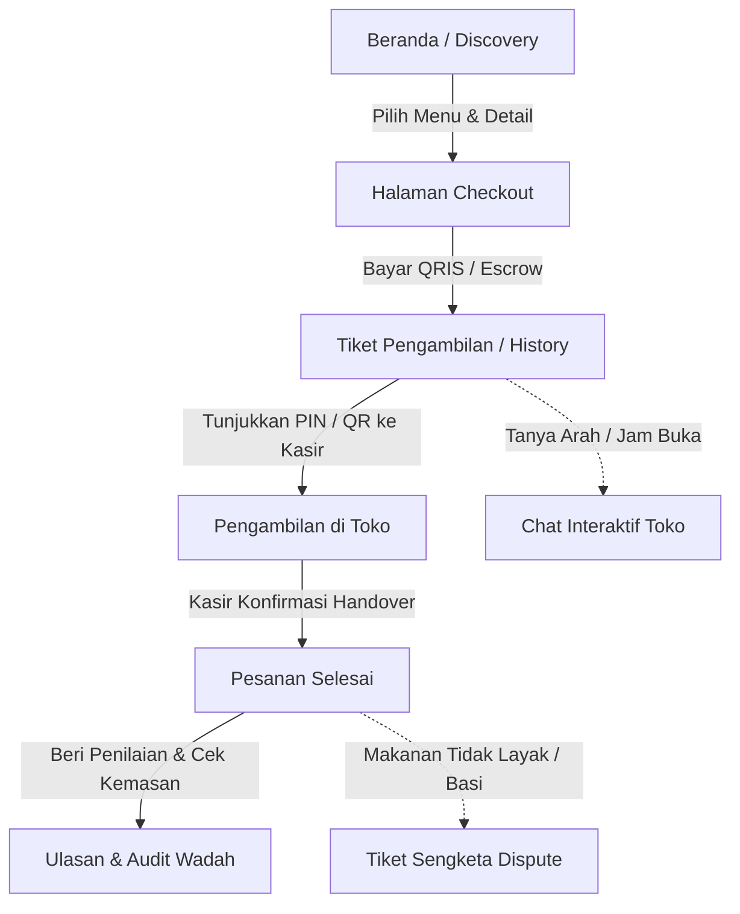
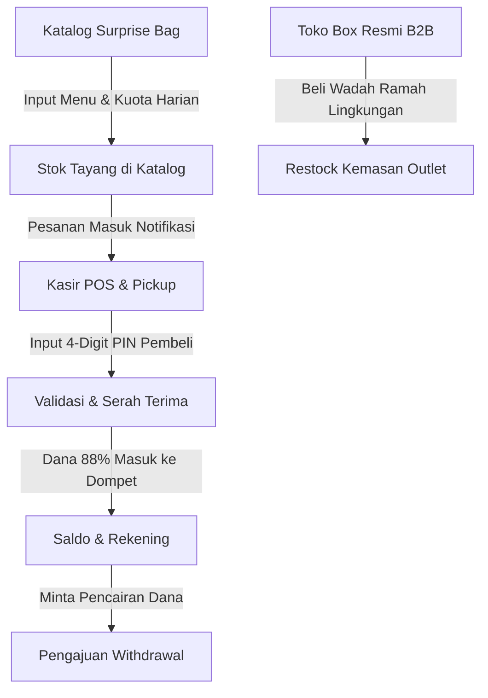
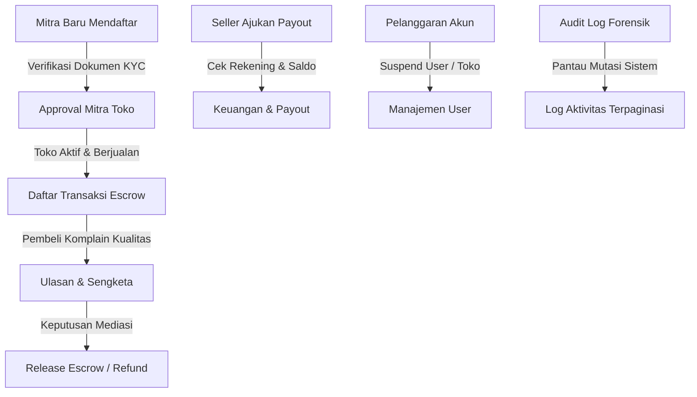

# Alur Kerja Peran Sistem & Rekomendasi Peningkatan UI - FoodRescue

Dokumen ini menyajikan pemetaan alur operasional menyeluruh untuk 3 peran sistem (**Pelanggan / Buyer**, **Mitra Toko / Seller**, dan **Administrator / Admin**), rincian alur navigasi per sub-menu, interaksi antar-layanan (state machine & data flow), serta evaluasi komprehensif peningkatan antarmuka (UI/UX) berbasis standar *Anti-Slop* dan *Design Craftsmanship*.

---

## 1. Pemetaan Peran & Ringkasan Tanggung Jawab

| Peran (Role) | Target Pengguna | Ruang Lingkup Utama | Entitas Kunci |
| :--- | :--- | :--- | :--- |
| **Buyer** (Pelanggan) | Konsumen pemburu makanan surplus berkualitas | Eksplorasi katalog, reservasi & pembayaran escrow, tiket pickup PIN/QR, chat koordinasi, ulasan kepatuhan wadah. | `orders`, `reviews`, `chat_messages` |
| **Seller** (Mitra Toko) | Pemilik outlet bakery, resto, kafe, & swalayan | Manajemen kuota Surprise Bag, kasir POS serah terima pesanan, pembelian wadah resmi B2B, penarikan saldo dompet. | `stores`, `surprise_bags`, `box_orders`, `withdrawals` |
| **Admin** (Super Admin) | Tim operasional & kepatuhan platform | Verifikasi KYC mitra baru, mediasi sengketa & pelepasan escrow, persetujuan payout, audit wadah, forensik audit log. | `users`, `escrow_accounts`, `audit_logs`, `disputes` |

---

## 2. Alur Kerja & Sub-Menu Peran Pelanggan (Buyer)

### Rincian Sub-Menu Buyer

#### 1. Beranda & Eksplorasi Katalog (`/` & `/buyer`)
* **Tujuan**: Memungkinkan pembeli menemukan makanan berlebih dengan diskon 50% hingga 70% di sekitar lokasinya sebelum jam tutup toko.
* **Fitur Utama**:
  * Filter kategori: *Bakery & Pastry*, *Makanan Berat*, *Kafe & Minuman*, *Swalayan & Buah*.
  * Toggle visualisasi: Grid kartu menu vs. Peta interaktif radius toko.
  * Tag *Flash Sale (Last Call)* untuk paket makanan yang wajib diselamatkan dalam 60 menit terakhir.
  * Modal detail Surprise Bag: estimasi komposisi isi, jam pickup (misal: 19:30 - 21:00 WIB), peringatan alergen, estimasi berat (kg), dan sisa kuota hari ini.
  * Tombol CTA: *Ambil Surprise Bag Sekarang*.

#### 2. Checkout & Rekening Penampung Escrow (`/checkout`)
* **Tujuan**: Transaksi pemesanan terproteksi di mana dana tidak langsung masuk ke rekening toko sebelum makanan diterima secara fisik.
* **Fitur Utama**:
  * Ringkasan pesanan & rincian harga (Subtotal + Biaya Layanan Aplikasi Rp 1.000).
  * Opsi metode pembayaran: QRIS instan otomatis, Virtual Account, atau Bayar di Kasir (COD).
  * Input nama pembeli dan nomor WhatsApp aktif (disimpan di penyimpanan lokal untuk pemesanan berikutnya).
  * Countdown timer pembayaran aktif (15 menit).
  * Banner jaminan: Dana diamankan di Rekening Penampung (Escrow) hingga pesanan berhasil diambil.

#### 3. Tiket Pengambilan Cepat (`/tickets` -> dialihkan ke `/history`)
* **Tujuan**: Sarana validasi fisik saat pembeli tiba di kasir outlet mitra.
* **Fitur Utama**:
  * Kode unik pengambilan berupa 4-Digit PIN (contoh: `4829`) dengan ukuran font besar dan kontras tinggi.
  * QR Code dinamis untuk pemindaian scanner kasir.
  * Rincian alamat toko, nama cabang, dan rentang jam pengambilan.
  * Tombol navigasi rute Google Maps menuju lokasi toko.

#### 4. Riwayat Pesanan & Evaluasi Kepatuhan (`/history`)
* **Tujuan**: Memantau status seluruh transaksi aktif dan histori transaksi lampau.
* **Fitur Utama**:
  * Tab pemisah: *Pesanan Aktif* (status `PAID`, `READY_FOR_PICKUP`) vs *Riwayat Selesai* (`COMPLETED`, `CANCELLED`).
  * Modal Chat terisolasi per pesanan untuk koordinasi langsung dengan staf toko.
  * Form penilaian bintang (1-5) dan kolom review kepatuhan: Pembeli memvalidasi apakah toko menggunakan wadah resmi ramah lingkungan *Rescue Box* atau kemasan plastik sekali pakai biasa.
  * Tombol eskalasi *Laporkan Masalah / Ajukan Sengketa* jika makanan yang diterima tidak layak konsumsi.

#### 5. Ruang Obrolan Terisolasi (`/chat`)
* **Tujuan**: Komunikasi dua arah langsung antara pembeli dan kasir toko tanpa perlu bertukar nomor kontak pribadi.
* **Fitur Utama**:
  * Thread pesan terikat langsung ke ID Pesanan (`orderId`).
  * Auto-lock obrolan: Fitur chat otomatis dikunci jika pesanan telah selesai atau dibatalkan untuk mencegah penyalahgunaan.

#### 6. Profil & Jejak Lingkungan (`/account`)
* **Tujuan**: Menampilkan kontribusi nyata pembeli terhadap pencegahan sampah makanan (*food waste impact tracker*).
* **Fitur Utama**:
  * Metrik dampak: Total kilogram makanan yang berhasil diselamatkan, perkiraan penurunan emisi karbon CO2 (kg), dan total rupiah yang dihemat.
  * Data profil pelanggan dan riwayat pesanan ringkas.

---

## 3. Alur Kerja & Sub-Menu Peran Mitra Toko (Seller)

### Rincian Sub-Menu Seller

#### 1. Kasir POS & Serah Terima Pickup (`/seller`)
* **Tujuan**: Antarmuka kasir cepat bagi staf toko untuk memvalidasi dan menyerahkan pesanan kepada pembeli tanpa antrean panjang.
* **Fitur Utama**:
  * Input 4-digit PIN pengambilan dari pembeli dengan tombol validasi instan.
  * Tombol 1-klik *Serah Terima Makanan* pada daftar antrean pesanan.
  * Daftar pesanan berstatus `PAID` dan `READY_FOR_PICKUP` dengan live badge counter.
  * Tombol buka obrolan cepat (Chat Modal) untuk membalas pembeli yang sedang dalam perjalanan menuju outlet.
  * Peringatan kepatuhan: Petunjuk agar kasir wajib menggunakan wadah resmi Rescue Box saat menyerahkan makanan.

#### 2. Manajemen Katalog Surprise Bag (`/seller/bags`)
* **Tujuan**: Mengatur menu makanan surplus yang akan dijual pada hari tersebut beserta kuota dan jam pengambilannya.
* **Fitur Utama**:
  * Tombol *Tambah Surprise Bag Baru*: Form input judul menu, kategori usaha, deskripsi, harga asli, harga diskon (50-70%), jam pickup, informasi alergen, dan upload foto banner ke storage S3.
  * Pengatur kuota harian (`quotaToday` dan `quotaRemaining`) per varian paket.
  * Toggle sakelar ketersediaan (*Aktif / Nonaktif*).
  * Toggle sakelar *Diskon Kilat (Last Call)* untuk mendorong penjualan cepat sebelum outlet tutup.

#### 3. Riwayat Pesanan & Analitik Penjualan (`/seller/orders`)
* **Tujuan**: Rekapitulasi transaksi penjualan, performa harian, dan transparansi bagi hasil toko.
* **Fitur Utama**:
  * Tabel riwayat pesanan: Nomor pesanan, waktu transaksi, nama pembeli, menu yang dibeli, nominal kotor, dan pendapatan bersih toko (88% setelah bagi hasil platform 12%).
  * Filter status transaksi (`Semua`, `Selesai`, `Dibatalkan`).
  * Ringkasan kuantitatif total porsi makanan terselamatkan.

#### 4. Toko Suplai Kemasan Resmi B2B (`/seller/boxes`)
* **Tujuan**: Menjamin standarisasi kemasan ramah lingkungan dan kepatuhan food safety melalui pembelian wadah resmi Rescue Box bersubsidi.
* **Fitur Utama**:
  * Indikator sisa inventaris box di outlet (`currentBoxStock`).
  * Notifikasi peringatan otomatis jika stok box menipis (di bawah 10 unit).
  * Katalog paket pembelian grosir: Paket Starter (50 box), Paket Reguler (100 box), dan Paket Grosir Hemat (200 box).
  * Konfirmasi pesanan suplai kemasan dengan alamat pengiriman cabang outlet.
  * Riwayat status pengiriman logistik paket box ke toko.

#### 5. Saldo Dompet & Rekening Bank (`/seller/finance`)
* **Tujuan**: Pengelolaan hasil penjualan makanan dan proses penarikan dana ke rekening perbankan mitra.
* **Fitur Utama**:
  * Tampilan saldo dompet aktif (*Wallet Balance*) yang siap dicairkan.
  * Informasi rekening bank terdaftar (Nama Bank, Nomor Rekening, Nama Pemilik Rekening).
  * Form permohonan penarikan dana (*Withdrawal Request*) dengan validasi batas minimal saldo.
  * Tabel riwayat pengajuan penarikan dana lengkap dengan status persetujuan (`Menunggu`, `Disetujui`, `Ditolak`).

---

## 4. Alur Kerja & Sub-Menu Peran Administrator (Admin)

### Rincian Sub-Menu Admin

#### 1. Beranda Ringkasan & Analitik Platform (`/admin`)
* **Tujuan**: Pemantauan indikator kinerja utama (KPI) ekosistem platform secara makro.
* **Fitur Utama**:
  * Metrik utama: Gross Merchandise Value (GMV), total porsi makanan diselamatkan, total mitra toko aktif, total ulasan masuk.
  * Grafik volume transaksi harian dan tingkat kepatuhan kemasan mitra secara agregat.
  * Peringatan toko yang memiliki stok kemasan kritis atau menerima ulasan kepatuhan buruk.

#### 2. Kurasi & Verifikasi Mitra Toko (`/admin/mitra`)
* **Tujuan**: Validasi legalitas dan kelayakan standar operasional mitra kuliner sebelum diizinkan menjual makanan ke publik.
* **Fitur Utama**:
  * Daftar toko berstatus `PENDING_APPROVAL`.
  * Dialog peninjauan berkas KYC: Foto KTP pemilik, foto tampak depan outlet, dan sertifikat halal bila ada.
  * Tombol aksi keputusan: *Setujui Mitra (ACTIVE)* atau *Tolak / Tangguhkan (SUSPENDED)*.

#### 3. Monitoring Transaksi & Escrow (`/admin/transaksi`)
* **Tujuan**: Transparansi pengawasan pergerakan dana di rekening penampung sementara (escrow).
* **Fitur Utama**:
  * Tabel transaksi menyeluruh lintas toko.
  * Rincian pemisahan dana per pesanan: Gross Total, Biaya Layanan Aplikasi (Rp 1.000), Komisi Platform (12%), dan Hak Bersih Mitra (88%).
  * Filter status transaksi (`PAID`, `READY_FOR_PICKUP`, `COMPLETED`, `DISPUTED`).

#### 4. Keuangan & Persetujuan Pencairan Dana (`/admin/keuangan`)
* **Tujuan**: Pengawasan arus kas keluar (payout) dan verifikasi pencairan dana ke rekening mitra toko.
* **Fitur Utama**:
  * Daftar antrean permohonan penarikan dana (`WithdrawalRequest`).
  * Informasi verifikasi rekening bank tujuan mitra toko.
  * Tombol eksekusi verifikasi: *Setujui Pencairan (Approve Payout)* yang secara otomatis mendebit saldo dompet toko di sistem.
  * Log histori pembayaran B2B paket wadah resmi Rescue Box dari mitra.

#### 5. Manajemen Pengguna Terpusat (`/admin/users`)
* **Tujuan**: Tata kelola akun seluruh entitas yang berinteraksi di dalam platform.
* **Fitur Utama**:
  * Tabel data pengguna dengan visualisasi avatar dan penanda peran (`buyer`, `seller`, `admin`).
  * Filter berdasarkan peran dan status akun.
  * Pencarian instan berdasarkan nama, email, atau nomor kontak.
  * Tombol kontrol keamanan: *Tangguhkan Akun (Suspend)* atau *Aktifkan Kembali (Activate)* untuk mencegah aksi penipuan atau spam.

#### 6. Audit Kepatuhan Wadah & Sengketa Ulasan (`/admin/audit`)
* **Tujuan**: Pengawasan kepatuhan SOP kemasan resmi dan penanganan sengketa berbasis laporan nyata ulasan pembeli.
* **Fitur Utama**:
  * Scoreboard metrik tabular: Total ulasan, persentase kepatuhan wadah resmi, jumlah pelanggaran kemasan, rata-rata rating.
  * Tab filter cepat: *Semua*, *Pelanggaran Wadah*, *Rating Rendah (<=3)*, dan *Sengketa Pesanan*.
  * Kartu ulasan kaya konteks: Identitas pembeli, nama toko cabang, nomor pesanan, kutipan ulasan, dan badge kepatuhan kemasan.
  * Tombol tindakan operasional: *Peringatkan Mitra* (bagi pelanggar standar kemasan) dan *Tandai Diperiksa*.
  * Mediasi sengketa transaksi: Pelepasan dana escrow ke toko atau penerbitan refund ke pembeli jika makanan terbukti basi.

#### 7. Audit Log Aktivitas Sistem (`/admin/audit-logs`)
* **Tujuan**: Rekam jejak forensik keamanan sistem untuk audit kepatuhan dan pelacakan peristiwa penting.
* **Fitur Utama**:
  * Pencatatan otomatis mutasi sistem (aktor, timestamp WIB, aksi, entitas ID, rincian peristiwa, IP address).
  * Filter cepat berdasarkan peran aktor (Semua, Admin, Seller, Buyer).
  * Pencarian live dengan debouncing 300ms.
  * Navigasi halaman menggunakan komponen Shadcn Pagination (`PaginationPrevious`, `PaginationLink`, `PaginationEllipsis`, `PaginationNext`) dengan SWR `keepPreviousData` bebas flicker.

---

## 5. Evaluasi & Rekomendasi Peningkatan Antarmuka (UI/UX Improvement)

Berdasarkan audit desain dan standar *Anti-Slop*, berikut adalah daftar rekomendasi konkret untuk meningkatkan kenyamanan, efisiensi, dan craftmanship antarmuka di setiap peran:

### A. Peningkatan UI untuk Peran Pelanggan (Buyer)

1. **Halaman Khusus Tiket Pengambilan Cepat (`/tickets`)**:
   * *Kondisi Saat Ini*: Route `/tickets` saat ini langsung me-redirect pembeli ke `/history`. Pembeli harus memilih tab *Pesanan Aktif* terlebih dahulu.
   * *Rekomendasi UI*: Buat halaman mandiri bertema *Digital Boarding Pass / Pickup Pass*:
     * Kartu tiket bergaya dompet digital dengan latar belakang kontras tinggi.
     * Kode QR besar dan PIN 4-digit berukuran besar (font monospace tabular) yang mudah dibaca oleh kasir dari jarak 1 meter.
     * Progress bar waktu penjemputan dengan indikator countdown: jika waktu tersisa kurang dari 30 menit, kartu memberikan aksen visual peringatan ramah.
     * Tombol 1-klik *Arahkan ke Google Maps* yang langsung membuka navigasi GPS.

2. **Transparansi Jaminan Escrow pada Halaman Checkout (`/checkout`)**:
   * *Kondisi Saat Ini*: Rincian biaya admin Rp 1.000 tercantum, namun konteks proteksi pembeli belum ditonjolkan.
   * *Rekomendasi UI*: Tambahkan lencana mikro bertuliskan: *"Garansi 100% Uang Kembali: Dana Anda disimpan aman di Escrow hingga makanan selesai Anda ambil di kasir."* Ini menghilangkan keraguan pembeli baru saat memesan makanan berlebih.

3. **Interaktivitas Ulasan Kepatuhan Kemasan (`/history`)**:
   * *Kondisi Saat Ini*: Pembeli hanya memiliki satu tombol review standar.
   * *Rekomendasi UI*: Tampilkan kartu konfirmasi ramah lingkungan dengan pertanyaan visual sederhana pasca-pengambilan: *"Apakah toko menyerahkan makanan menggunakan wadah resmi Rescue Box?"* dengan dua tombol pilihan visual (Iya, Sesuai Standar / Tidak, Wadah Plastik Biasa) plus opsi lampiran foto bukti.

### B. Peningkatan UI untuk Peran Mitra Toko (Seller)

1. **Mode Kasir Layar Penuh (Fullscreen POS Mode) (`/seller`)**:
   * *Kondisi Saat Ini*: Kasir toko melihat sidebar navigasi lengkap dan informasi pendukung yang berpotensi membingungkan staf kasir di jam sibuk (19:00 - 21:00 WIB).
   * *Rekomendasi UI*: Tambahkan tombol toggle *Mode Kasir Fokus*:
     * Menyembunyikan sidebar dan menampilkan numpad virtual layar sentuh berukuran besar untuk input 4-digit PIN.
     * Feedback audio chime halus (menggunakan Web Audio API sederhana) saat pesanan berhasil divalidasi.
     * Ringkasan kuota pickup yang tersisa hari ini pada sudut atas layar.

2. **Visualisasi Inventaris Kuota Bertingkat (`/seller/bags`)**:
   * *Kondisi Saat Ini*: Kuota diubah menggunakan tombol angka sederhana tanpa indikator visual urgensi.
   * *Rekomendasi UI*: Tambahkan bar persentase sisa kuota:
     * Hijau saat stok aman (> 3 paket).
     * Kuning saat stok tersisa 1-2 paket.
     * Merah/Abu-abu saat habis terjual dengan tombol 1-klik *Tandai Habis Hari Ini (Sold Out)*.

3. **Kalkulator Kebutuhan Kemasan B2B (`/seller/boxes`)**:
   * *Kondisi Saat Ini*: Toko hanya melihat paket kemasan statis tanpa rekomendasi estimasi.
   * *Rekomendasi UI*: Tampilkan kotak cerdas: *"Berdasarkan penjualan rata-rata Anda (7 box/hari), stok 15 box Anda saat ini diperkirakan habis dalam 2 hari ke depan. Disarankan memesan Paket Reguler (100 box)."*

### C. Peningkatan UI untuk Peran Administrator (Admin)

1. **Pusat Aksi Cepat / Urgent Action Feed (`/admin`)**:
   * *Kondisi Saat Ini*: Beranda menampilkan metrik statistik agregat, tetapi admin harus membuka sub-menu satu per satu untuk melihat pekerjaan yang tertunda.
   * *Rekomendasi UI*: Tambahkan panel atas *Perlu Tindakan Anda (Action Required)*:
     * Badge jumlah mitra baru yang menunggu verifikasi KYC.
     * Badge jumlah penarikan dana toko yang menunggu persetujuan payout.
     * Badge jumlah laporan pelanggaran kemasan yang belum diinspeksi.

2. **Split-Screen KYC Reviewer (`/admin/mitra`)**:
   * *Kondisi Saat Ini*: Verifikasi KTP mitra dibuka dalam dialog modal bertingkat.
   * *Rekomendasi UI*: Implementasikan tata letak split-view saat menginspeksi toko: sisi kiri menampilkan dokumen foto KTP dan outlet yang dapat di-zoom, sisi kanan menampilkan formulir isian data toko, disertai shortcut keyboard (`A` untuk setujui, `S` untuk tangguhkan).

3. **Salin Rekening 1-Klik & Ringkasan Cadangan Kas (`/admin/keuangan`)**:
   * *Kondisi Saat Ini*: Admin membaca nomor rekening bank mitra secara manual dari kartu daftar.
   * *Rekomendasi UI*:
     * Tombol salin 1-klik di samping nomor rekening bank dengan feedback visual *Tersalin!*.
     * Widget ringkasan kas: Total dana mengendap di escrow vs total permohonan penarikan dana aktif, memberikan kepastian likuiditas sebelum transfer bank diproses.

---

## 6. Matriks Perbandingan Sub-Menu Antar Peran

| Sub-Menu | Buyer | Seller | Admin |
| :--- | :--- | :--- | :--- |
| **Katalog & Discovery** | `/` (Cari makanan diskon) | `/seller/bags` (Kelola menu & kuota) | - |
| **Kasir & Validasi** | `/tickets` (Tampilkan PIN/QR) | `/seller` (Input PIN & serah terima) | - |
| **Pemesanan & Transaksi** | `/checkout` & `/history` | `/seller/orders` (Riwayat & margin 88%) | `/admin/transaksi` (Monitoring escrow) |
| **Komunikasi Langsung** | `/chat` (Chat per orderId) | Modal Chat di `/seller` & `/seller/orders` | - |
| **Kemasan & Kepatuhan** | Input review kemasan di `/history` | `/seller/boxes` (Beli box resmi B2B) | `/admin/audit` (Audit ulasan & sengketa) |
| **Keuangan & Saldo** | Pembayaran via QRIS di `/checkout` | `/seller/finance` (Tarik saldo dompet) | `/admin/keuangan` (Approve payout transfer) |
| **Kurasi & Pengguna** | `/account` (Profil & dampak lingkungan) | Profil Toko di `/seller/layout` | `/admin/mitra` (KYC) & `/admin/users` |
| **Forensik & Jejak Sistem** | - | - | `/admin/audit-logs` (Log aktivitas) |

---

*Dokumen ini disusun sebagai Single Source of Truth (SOT) arsitektur alur sub-menu dan roadmap peningkatan antarmuka (UI/UX) pada repositori FoodRescue.*
