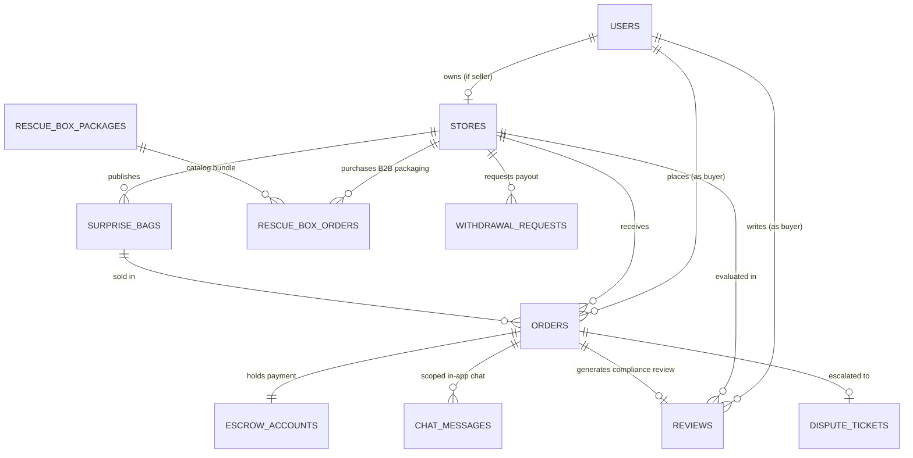

# Alur Schema & Model Relasi Data - FoodRescue

Dokumen ini mendokumentasikan arsitektur database, diagram relasi entitas (ERD), alur status transaksi (state machine), serta penetapan role sistem berbasis Drizzle ORM dan PostgreSQL.

---

## 1. Penyelarasan Role & Hak Akses (RBAC)

Penyelarasan role sistem di level database dan tampilan antarmuka (UI):

| Role di DB (`user_role`) | Label di UI | Deskripsi & Hak Akses |
| :--- | :--- | :--- |
| `buyer` | **Pelanggan** / **Pembeli** | Eksplorasi katalog, reservasi & pembayaran Surprise Bag, chat per pesanan, pengambilan langsung di toko dengan No. Pesanan/QR, memberikan rating & review kepatuhan box, pengajuan sengketa (dispute). |
| `seller` | **Mitra Toko** | Manajemen inventaris Surprise Bag, pengaturan jam operasional pickup, kasir POS serah terima pesanan (1-klik konfirmasi tanpa PIN rumit), pembelian kemasan ramah lingkungan (B2B Rescue Box), monitoring saldo & pengajuan penarikan dana (*withdrawal*). |
| `admin` | **Admin** (Super Admin) | Approval pendaftaran & verifikasi KYC mitra baru, moderasi sengketa (*escrow dispute release/refund*), approval pencairan dana toko, audit kepatuhan kemasan, dan kontrol penuh manajemen pengguna (*suspend/activate*, promosi role). |

> **Catatan Rekomendasi Domain Model**:
> 1. Role `buyer` wajib dicatat secara eksplisit di database dan ditampilkan pada tabel **Manajemen Pengguna (`/admin/users`)** agar Admin memiliki kontrol audit jika terjadi pelanggaran (spam order, refund fraud, atau penipuan PIN).
> 2. Di level kodingan dan enum database, gunakan istilah baku berbahasa Inggris: `buyer`, `seller`, dan `admin`. Di level tampilan pengguna (UI), gunakan istilah ramah: **Pelanggan**, **Mitra Toko**, dan **Admin**.

---

## 2. Diagram Relasi Entitas (ERD)

---

## 3. Detail 11 Tabel Database (`src/db/schema.ts`)

### 1. `users` (Akun Pengguna Terpusat)
Menyimpan identitas semua pengguna sistem (Pembeli, Mitra Toko, dan Admin).
- `id` (text, PK): Pengenal unik akun (e.g. `user-buyer-1`).
- `name` (text, not null): Nama lengkap pengguna.
- `email` (text, not null, unique): Alamat email unik (login credential).
- `phone` (text, not null): Nomor WhatsApp aktif.
- `role` (enum: `buyer`, `seller`, `admin`): Penentu otorisasi dan tata letak menu.
- `status` (text, default `ACTIVE`): Status akun (`ACTIVE` atau `SUSPENDED`).
- `avatarUrl` (text): URL foto profil (default: DiceBear Adventurer Neutral SVG atau URL S3 Dahono).
- `storeId` (text, nullable): Referensi ke toko jika user adalah `seller`.
- `created_at` / `updated_at` (timestamp).

### 2. `stores` (Profil Mitra & Finansial Outlet)
Menyimpan profil toko, data geolokasi, kepatuhan kemasan, dan saldo dompet.
- `id` (text, PK): ID toko (e.g. `store-ruby-bakery`).
- `name` (text, not null): Nama outlet/brand toko.
- `category` (enum: `Bakery & Pastry`, `Makanan Berat`, `Kafe & Minuman`, `Swalayan & Buah`).
- `address`, `area`, `latitude`, `longitude`: Titik koordinat dan alamat fisik.
- `rating` (numeric 3,2), `review_count` (int): Reputasi toko dari penilaian pembeli.
- `status` (enum: `PENDING_APPROVAL`, `ACTIVE`, `SUSPENDED`): Status kurasi mitra.
- `pickup_start_time`, `pickup_end_time` (text): Rentang waktu pengambilan pesanan (e.g. "19:00" - "21:00").
- `box_compliance_rate` (int, default 100): Persentase kepatuhan penggunaan kemasan resmi.
- `boxes_sold_total` (int), `current_box_stock` (int): Pelacakan inventaris kemasan B2B.
- `wallet_balance` (int): Saldo bersih hasil penjualan yang siap dicairkan (Rp).
- `bank_account` (jsonb): Info rekening bank mitra (`bankName`, `accountNumber`, `accountHolder`).
- `kyc_details` (jsonb): Dokumen verifikasi (`ktpNumber`, `ownerName`, `ktpImage`, `storeFrontImage`).

### 3. `surprise_bags` (Katalog Makanan Berlebih)
Paket blind-box makanan surplus yang ditawarkan dengan diskon 50-70%.
- `id` (text, PK): ID paket kantong (e.g. `bag-ruby-1`).
- `store_id` (text, FK -> `stores.id`): Toko pemilik menu.
- `title`, `description`, `category`: Informasi menu.
- `original_price` (int), `discounted_price` (int): Skema harga diskon.
- `quota_today` (int), `quota_remaining` (int): Alokasi stok harian.
- `is_active` (boolean), `is_last_call` (boolean): Flag ketersediaan dan penawaran kilat penutupan toko.
- `pickup_window` (text): Jam ambil pesanan.
- `estimated_weight_kg` (double precision): Estimasi berat makanan (untuk kalkulasi jejak karbon).

### 4. `orders` (Pesanan & Transaksi Escrow)
Mencatat transaksi pembelian Surprise Bag oleh pembeli dari toko mitra.
- `id` (text, PK): Nomor pesanan (e.g. `RB-8492`).
- `buyer_id` (text, FK -> `users.id`), `store_id` (text, FK -> `stores.id`), `bag_id` (text, FK -> `surprise_bags.id`).
- `quantity`, `unit_price`, `subtotal_price`, `admin_fee` (Rp 1.000), `total_price`.
- `platform_fee` (int): Bagi hasil platform (12% dari subtotal).
- `seller_earning` (int): Pendapatan bersih mitra toko (88% dari subtotal).
- `status` (enum: `PENDING_PAYMENT`, `PAID`, `READY_FOR_PICKUP`, `COMPLETED`, `EXPIRED`, `CANCELLED`, `DISPUTED`).
- `pickup_code` (text, 4-digit PIN e.g. "4829"), `pickup_qr_data` (text).
- `is_chat_locked` (boolean): Otomatis terkunci saat pesanan selesai atau dibatalkan.

### 5. `escrow_accounts` (Rekening Penampung Sementara)
Menjamin keamanan dana transaksi hingga pesanan diterima oleh pembeli.
- `id` (text, PK): ID escrow (e.g. `escrow-RB-8492`).
- `order_id` (text, unique, FK -> `orders.id`).
- `held_amount` (int): Total dana yang ditahan.
- `status` (enum: `HELD`, `RELEASED_TO_SELLER`, `REFUNDED_TO_BUYER`).
- `held_at`, `released_at` (timestamp).

### 6. `chat_messages` (Komunikasi Khusus Pesanan)
Ruang obrolan terisolasi antara pembeli dan kasir toko untuk koordinasi pengambilan barang.
- `id` (text, PK): ID pesan.
- `order_id` (text, FK -> `orders.id`): Mengunci konteks obrolan hanya pada nomor pesanan terkait.
- `sender_role` (text: `buyer`, `seller`, `system`), `sender_name`, `text`.

### 7. `rescue_box_packages` & `rescue_box_orders` (B2B Kemasan)
Katalog kemasan resmi biodegradable bersertifikat untuk mitra toko dan histori pengirimannya.
- Paket: `box-50` (50 pcs - Rp 65.000), `box-100` (100 pcs - Rp 120.000), `box-200` (200 pcs - Rp 220.000).
- Order melacak: `store_id`, `quantity_pcs`, `total_price`, `tracking_number`, dan `status` (`PENDING`, `PROCESSING`, `SHIPPED`, `DELIVERED`).

### 8. `reviews` (Rating & Audit Kepatuhan Kemasan)
Mekanisme pengawasan *crowdsourcing* dari pembeli untuk memastikan makanan dikemas dalam wadah higienis resmi.
- `rating` (1 - 5), `comment` (text).
- `used_official_rescue_box` (boolean): Indikator utama penghitungan skor kepatuhan toko (`box_compliance_rate`).

### 9. `withdrawal_requests` (Pencairan Saldo Dompet Mitra)
Pengajuan penarikan penghasilan bersih penjualan toko ke rekening bank.
- `amount` (int), `bank_name`, `account_number`, `account_holder`.
- `status` (enum: `PENDING`, `APPROVED`, `REJECTED`).

### 10. `dispute_tickets` (Penanganan Keluhan & Mediasi Admin)
Eskalasi masalah jika makanan basi, toko tutup saat jam pickup, atau pesanan tidak sesuai deskripsi.
- Menghubungkan pembeli, toko, dan admin untuk investigasi sebelum dana escrow dilepas atau dikembalikan (*refund*).

---

## 4. Alur Siklus Hidup Transaksi (State Machine Flow)

### A. Alur Pemesanan & Serah Terima Pesanan (Seperti Gojek / GrabFood Takeaway)
1. **Checkout & Pembayaran**: Pembeli memilih kantong makanan -> Pembeli membayar -> Status langsung terkonfirmasi `PAID` (Terbayar), pesanan memperoleh No. Pesanan resmi (misal `RB-8492`), dan dana penampung masuk ke `escrow_accounts` dengan status `HELD`.
2. **Koordinasi Pickup**: Pembeli dan Mitra dapat berkirim pesan via `chat_messages` yang terikat pada `order_id` untuk konfirmasi perkiraan waktu tiba di toko.
3. **Pengambilan Fisik di Toko**: Pembeli langsung datang ke outlet toko pada jam operasional pickup dan menunjukkan nomor pesanan atau QR code.
4. **Pelepasan Dana Otomatis**: Kasir toko menekan tombol 1-klik **Serahkan** pada kasir POS (`/seller`) berdasarkan No. Pesanan -> Status order menjadi `COMPLETED` -> Sistem mengubah status escrow menjadi `RELEASED_TO_SELLER` -> Saldo bersih (`seller_earning` 88%) otomatis bertambah ke `stores.wallet_balance` -> Ruang chat pesanan dikunci (`is_chat_locked = true`).
5. **Audit Kemasan**: Pembeli memberikan ulasan dan mencentang apakah toko menggunakan kemasan resmi -> Nilai kepatuhan toko (`box_compliance_rate`) diperbarui secara real-time.

### B. Alur Sengketa (Dispute Resolution)
1. Jika pembeli tiba di lokasi dan toko ternyata tutup, pembeli mengajukan sengketa via halaman tiket pesanan.
2. Status order beralih menjadi `DISPUTED` dan sistem menahan status escrow (`HELD`).
3. Admin menginspeksi log obrolan dan bukti foto di dashboard `/admin/audit`.
4. Jika keluhan valid, Admin menekan opsi **Refund ke Pembeli** (status escrow berubah ke `REFUNDED_TO_BUYER`). Jika tidak valid, Admin menekan **Lepas ke Penjual** (`RELEASED_TO_SELLER`).
