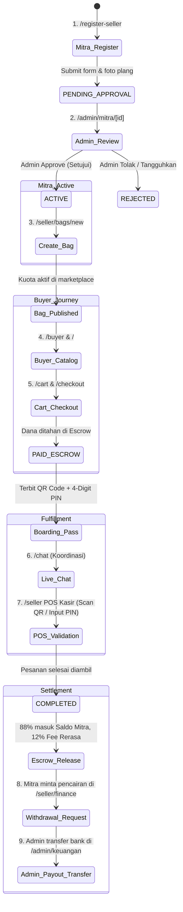

# Rerasa (FoodRescue) — End-to-End Project Workflow & Architectural Lifecycle Spec

**Document Version:** 1.0.0  
**Target Environment:** Local Dev / Simulation & Live Production (`https://rerasa.fizaa.me`)  
**Core Purpose:** Panduan resmi alur kerja multi-role (Mitra Toko, Super Admin, dan Pembeli) dari pendaftaran merchant, verifikasi gerai, penerbitan paket surplus, reservasi pembeli, validasi POS kasir, hingga pencairan dana escrow.

---

## 1. Arsitektur State Machine & Siklus Status Data



---

## 2. Rincian Alur 6 Fase Operasional

### Fase 1: Pendaftaran Mitra & Pengajuan KYC (`/register-seller`)
1. **Aksi Mitra**:
   - Membuka halaman pendaftaran merchant `/register-seller`.
   - Mengisi identitas toko (Nama gerai, kategori makanan, alamat geolokasi Cirebon, rekening bank, jam operasional pickup malam).
   - Mengunggah foto bukti fisik gerai/plang toko.
2. **State Output**:
   - Record toko tercipta dengan status: `PENDING_APPROVAL`.
   - Gerai belum tampil di marketplace publik pembeli.

### Fase 2: Audit & Verifikasi oleh Super Admin (`/admin/mitra/[id]`)
1. **Aksi Admin**:
   - Membuka menu kelola mitra di `/admin/mitra` atau dedicated page `/admin/mitra/[id]`.
   - Memeriksa keabsahan plang fisik gerai dan nomor rekening penampung.
   - Menekan tombol **"Setujui Gerai (Aktifkan)"**.
2. **State Output**:
   - Status toko bertransisi menjadi: `ACTIVE`.
   - Akun merchant diaktifkan untuk dapat login ke portal `/seller`.

### Fase 3: Pengelolaan Katalog Surplus Bag (`/seller/bags/new`)
1. **Aksi Mitra**:
   - Login ke portal mitra `/seller`.
   - Menuju menu `/seller/bags/new` untuk menerbitkan paket kejutan surplus hari itu.
   - Memasukkan parameter: Nama paket, kuota porsi, jam pickup (misal 19.30 - 21.00 WIB), harga normal vs harga diskon (>50%), dan estimasi bobot porsi.
   - Mengontrol stok kemasan ramah lingkungan di `/seller/boxes`.
2. **State Output**:
   - Paket `SurpriseBag` terbit dengan status `ACTIVE` dan kuota tersedia (`availableStock > 0`).

### Fase 4: Penemuan & Pemesanan oleh Pembeli (`/buyer`, `/cart`, `/checkout`)
1. **Aksi Pembeli**:
   - Membuka katalog di `/buyer` atau `/`.
   - Memfilter makanan berdasarkan kategori atau flash sale.
   - Memasukkan paket ke keranjang (`/cart`) dan menuju `/checkout`.
   - Memasukkan nama dan nomor WhatsApp aktif, memilih metode pembayaran (QRIS / Tunai Kasir / Transfer VA).
2. **State Output**:
   - Pesanan dibuat dengan status: `PAID` atau `READY_FOR_PICKUP`.
   - Kuota paket berkurang secara real-time.
   - Dana pesanan ditahan di akun penampung **Escrow Platform**.
   - Sistem menerbitkan **Digital Boarding Pass** yang memuat QR Data unik dan 4-Digit Pickup PIN rahasia.

### Fase 5: Live Chat & Validasi POS Pengambilan (`/chat`, `/seller`)
1. **Koordinasi**:
   - Pembeli dan Mitra dapat berkoordinasi via room obrolan real-time `/chat?orderId=[id]`.
2. **Pengambilan di Gerai (Fulfillment)**:
   - Pembeli tiba di gerai sebelum jam tutup pickup dan menunjukkan Boarding Pass.
   - Kasir membuka aplikasi POS `/seller`.
   - Kasir memindai QR Code boarding pass atau memasukkan 4-Digit PIN.
3. **State Output**:
   - Status pesanan berpindah menjadi: `COMPLETED`.
   - Transaksi tercatat aman tanpa sengketa.

### Fase 6: Pencairan Escrow & Penarikan Dana Mitra (`/seller/finance`, `/admin/keuangan`)
1. **Bagi Hasil Otomatis**:
   - Sistem melepas dana dari Escrow:
     - 88% dari subtotal dikreditkan ke saldo dompet Mitra (`walletBalance`).
     - 12% dialokasikan sebagai pendapatan platform take-rate.
2. **Pencairan Saldo (Withdrawal)**:
   - Mitra mengajukan penarikan di `/seller/finance` (minimal Rp 50.000).
   - Super Admin meninjau permohonan di `/admin/keuangan`.
   - Admin mentransfer ke rekening bank mitra dan mengonfirmasi approval.
3. **Dampak Lingkungan (Impact)**:
   - Jejak penyelamatan makanan (Porsi selamat, kg surplus tertangani, jejak emisi CO₂ tereduksi) terakumulasi di profil pembeli (`/history`) dan dashboard analitik admin (`/admin`).

---

## 3. Matriks Hak Akses & Isolasi Data Per Peran

| Modul / URL | Pembeli (`buyer`) | Mitra Gerai (`seller`) | Super Admin (`admin`) |
| :--- | :---: | :---: | :---: |
| `/` & `/buyer` (Marketplace) | Akses Penuh | Hanya Baca | Hanya Baca |
| `/checkout` & `/tickets` | Akses Penuh | Dilarang | Hanya Baca |
| `/chat` | Chat Mitra Toko | Chat Pembeli Terkait | Monitoring / Audit |
| `/seller` (POS Kasir) | Dilarang | Akses Penuh Toko Sendiri | Dilarang |
| `/seller/bags/*` | Dilarang | Kelola Toko Sendiri | Dilarang |
| `/seller/finance` | Dilarang | Saldo & Penarikan Toko Sendiri | Dilarang |
| `/admin/*` (Seluruh Modul) | Dilarang | Dilarang | Akses Super Admin Penuh |

---

## 4. Prosedur Uji Mandiri Otomatis (Self-Test Execution)

Pengujian seluruh siklus di atas dapat dieksekusi secara mandiri kapan saja menggunakan automated E2E test runner:

```bash
bun run src/test/e2eSimulation.test.ts
```

Setiap pengujian memverifikasi secara deterministik:
1. Pendaftaran & KYC approval mitra gerai.
2. Isolasi katalog seller hanya untuk toko miliknya tanpa fallback hardcode.
3. Validasi kuota paket dan formula take-rate 12% : 88%.
4. Penerbitan Boarding Pass & verifikasi POS ganda (QR Scanner + 4-Digit PIN).
5. Solvensi likuiditas Escrow Vault dan pencairan saldo ke rekening mitra.
